# Medical Insurance Cost Prediction & Risk Analysis

[English](README.md) | [简体中文](README_CN.md)


## 1. Project Overview

This project develops a reproducible statistical modeling framework for medical insurance cost-level prediction and high-cost risk identification using Generalized Linear Models (GLMs).

Rather than focusing exclusively on predictive performance, the project integrates statistical inference, model diagnostics, nonlinear modeling, model selection, and out-of-sample evaluation.

### Research Objectives

- Identify factors associated with medical insurance cost levels.
- Predict nine ordered medical cost categories using ordinal logistic regression.
- Improve predictive performance through interaction effects and nonlinear modeling.
- Identify individuals at risk of entering the highest medical cost category.
- Address separation and unstable maximum likelihood estimates using Firth penalized logistic regression.

## 2. Key Results

| Task | Final Model | Key Performance |
|---|---|---|
| Ordinal classification | Spline-interaction cumulative logit | QWK = 0.9125 |
| Ordinal classification | Spline-interaction cumulative logit | Accuracy = 80.25% |
| High-cost identification | Quadratic Firth logistic regression | ROC-AUC = 0.9939 |
| High-cost identification | Quadratic Firth logistic regression | Recall = 94.12% |
| High-cost identification | Quadratic Firth logistic regression | F1 = 0.9412 |

All results above were obtained on held-out validation sets.

## 3. Dataset

The dataset was provided as part of a Generalized Linear Models course project.

- Number of observations: 1,338
- Number of original predictor columns: 9
- Number of reconstructed predictors: 6
- Target variable: Medical insurance cost level (0–8)
- Highest-cost observations: 113 (8.45%)

| Variable | Description | Type |
|---|---|---|
| age | Age of the insured individual | Numerical |
| sex | Sex indicator | Categorical |
| bmi | Body mass index | Numerical |
| children | Number of children | Count |
| smoker | Smoking status | Binary |
| region | Geographical region | Categorical |
| y | Medical insurance cost level | Ordinal |

The four original regional indicator columns were reconstructed into a single categorical variable.

Higher target values represent higher medical cost levels. The original monetary thresholds are not available.

## 4. Analytical Workflow

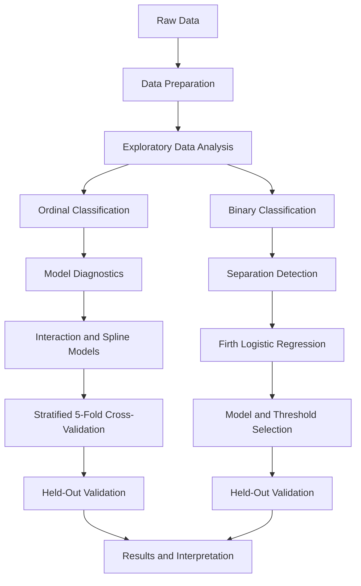

## 5. Exploratory Data Analysis

Exploratory analysis investigates the distribution of medical cost levels, demographic characteristics, smoking status, BMI, and their relationships with the response variable.

### Medical Cost-Level Distribution

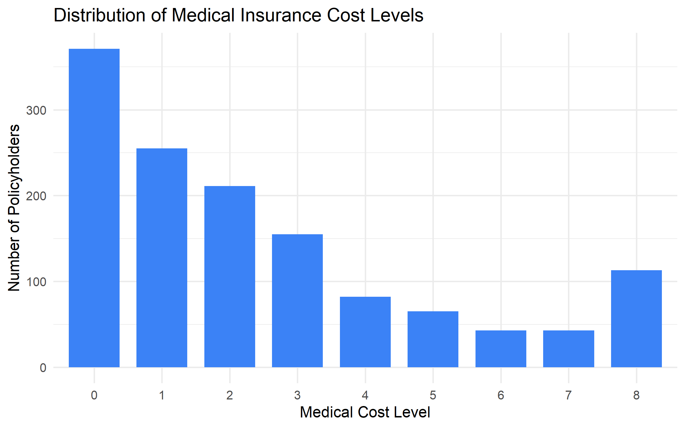

### BMI, Smoking Status and Medical Cost Levels

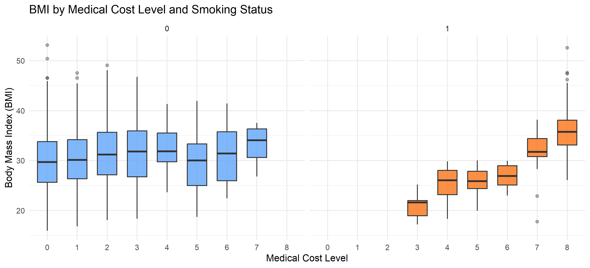

The observed data suggest a strong association between smoking status and medical cost levels, as well as a potentially nonlinear relationship involving BMI.

These findings motivate the introduction of interaction effects and nonlinear terms.

## 6. Ordinal Logistic Regression

### 6.1 Modeling Strategy

A cumulative logit model was used to preserve the ordering of the nine response categories.

Three candidate models were compared:

- Baseline proportional odds model
- Model with a BMI × smoking interaction
- Natural cubic spline model with a BMI × smoking interaction

The analysis included:

- Maximum likelihood estimation
- Likelihood ratio tests
- Proportional odds assumption diagnostics
- Multicollinearity assessment
- Numerical convergence diagnostics
- Nonlinear and interaction effect analysis

### 6.2 Model Selection

The data were divided into 933 training observations and 405 held-out validation observations.

Stratified five-fold cross-validation was conducted within the training set, using Quadratic Weighted Kappa (QWK) as the primary selection criterion.

| Model | Mean Accuracy | Mean MAE | Mean QWK |
|---|---:|---:|---:|
| Baseline | 0.7031 | 0.6989 | 0.8264 |
| Interaction | 0.7888 | 0.4845 | 0.8799 |
| **Spline interaction** | **0.7942** | **0.4460** | **0.8878** |

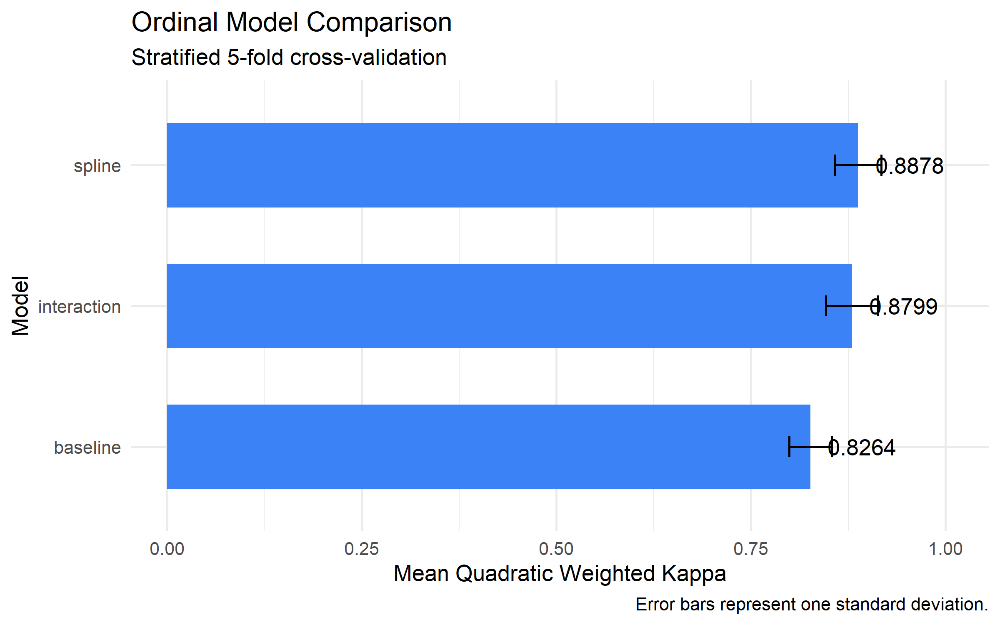

The spline-interaction model achieved the highest mean cross-validation QWK and was selected for final evaluation.

### 6.3 Held-Out Validation

| Metric | Result |
|---|---:|
| Accuracy | 80.25% |
| Mean Absolute Error | 0.3951 |
| Quadratic Weighted Kappa | 0.9125 |
| Within One Cost Level | 90.86% |
| Within Two Cost Levels | 93.83% |

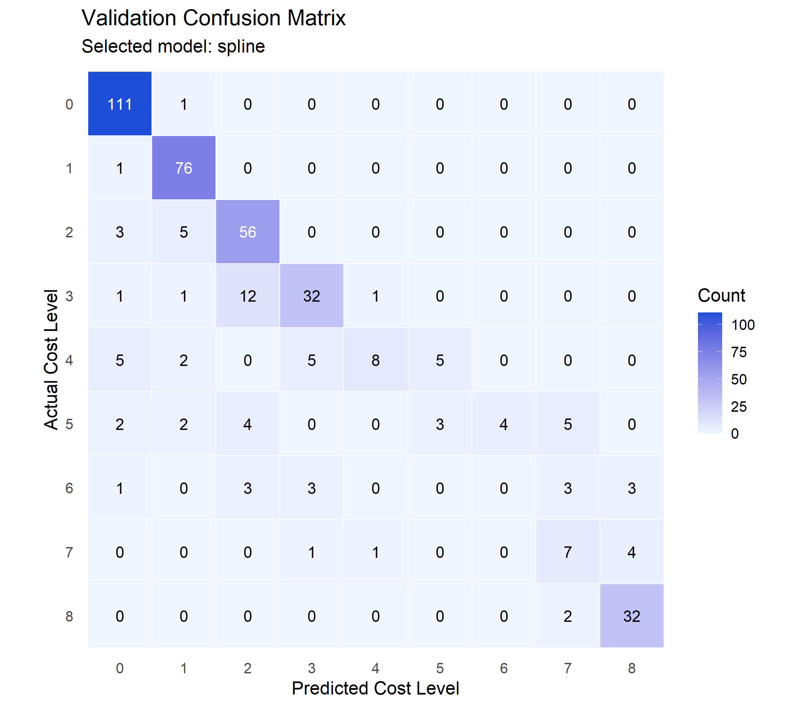

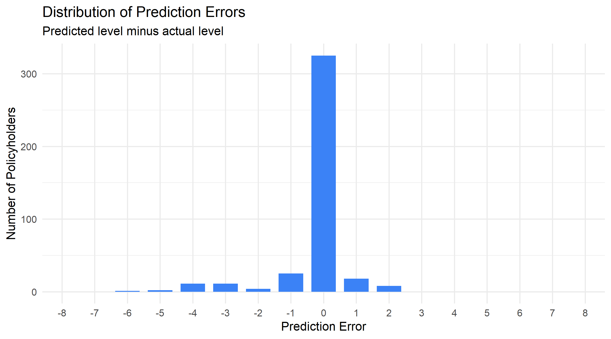

### 6.4 Nonlinear and Interaction Effects

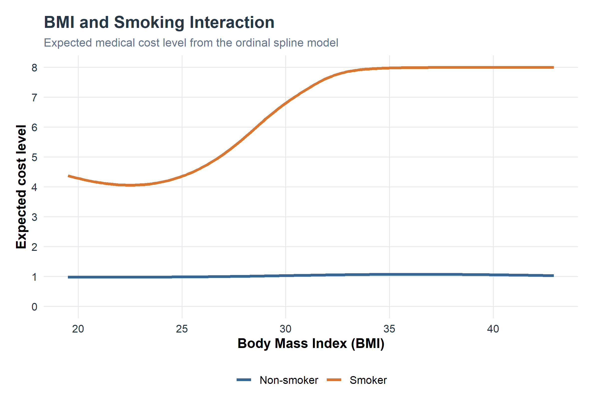

The model captures a nonlinear relationship between BMI and medical cost levels that varies with smoking status.

The proportional odds assumption was not fully satisfied. Therefore, the final model should be interpreted with appropriate caution despite its strong predictive performance.

## 7. High-Cost Risk Identification

### 7.1 Binary Target Definition

The highest medical cost category (y = 8) was defined as the positive class. All remaining categories were treated as negative.

| Dataset | Observations | Positive Cases |
|---|---:|---:|
| Training | 937 | 79 |
| Testing | 201 | 17 |
| Validation | 200 | 17 |

The testing set was used for model and threshold selection. The validation set was reserved for final evaluation.

### 7.2 Separation and Firth Correction

Ordinary binary logistic regression exhibited quasi-complete separation.

In the observed dataset, all highest-cost cases were smokers. Standard maximum likelihood estimation consequently produced unstable coefficient estimates and extremely large standard errors.

Firth penalized likelihood estimation was introduced to obtain finite, more stable parameter estimates.

### 7.3 Candidate Model Comparison

| Model | ROC-AUC | Log Loss | Brier Score |
|---|---:|---:|---:|
| Baseline Firth | 0.99968 | 0.02296 | 0.00589 |
| Interaction Firth | 0.99968 | 0.02472 | 0.00613 |
| Spline Firth | 1.00000 | 0.02101 | 0.00526 |
| **Quadratic Firth** | **1.00000** | **0.01820** | **0.00429** |

These results were obtained on the testing set.

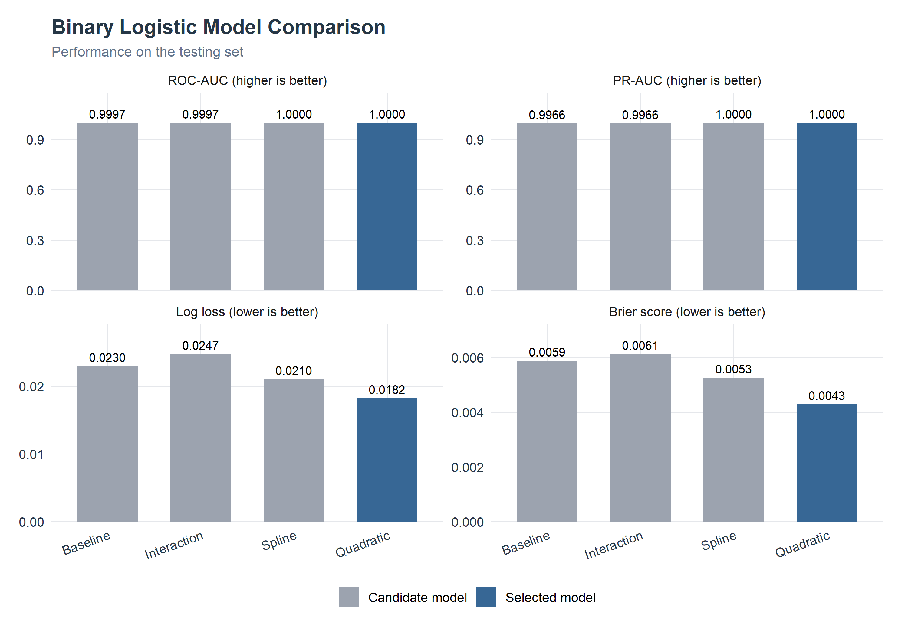

The quadratic Firth model was selected based on predictive performance, probability scoring, nonlinear term diagnostics, and model parsimony.

The final classification threshold was selected by maximizing F1 on the testing set:

**Threshold = 0.5379624**

### 7.4 Held-Out Validation Results

| Metric | Result |
|---|---:|
| ROC-AUC | 0.9939 |
| PR-AUC | 0.9657 |
| Average Precision | 0.9663 |
| Accuracy | 99.00% |
| Precision | 94.12% |
| Recall | 94.12% |
| Specificity | 99.45% |
| F1 Score | 0.9412 |
| Log Loss | 0.04627 |
| Brier Score | 0.00996 |

### ROC and Precision-Recall Curves

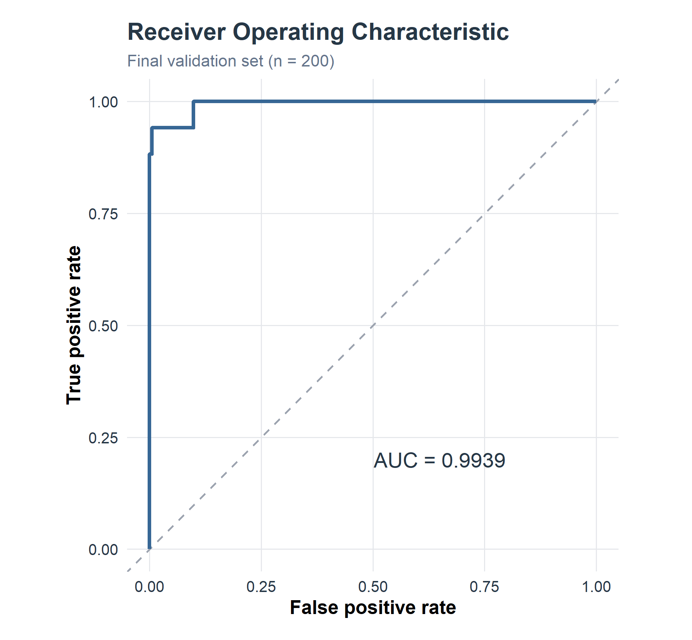

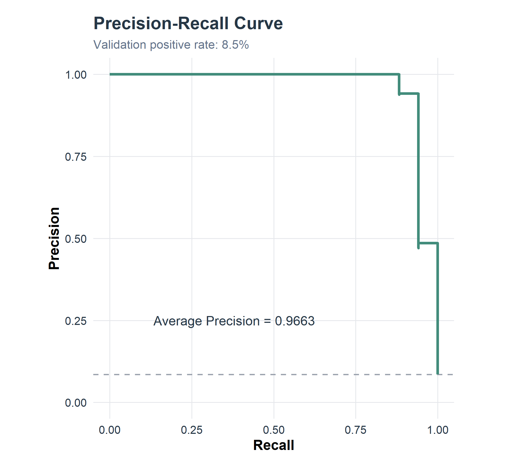

### Confusion Matrix

| Actual / Predicted | Negative | Positive |
|---|---:|---:|
| Negative | 182 | 1 |
| Positive | 1 | 16 |

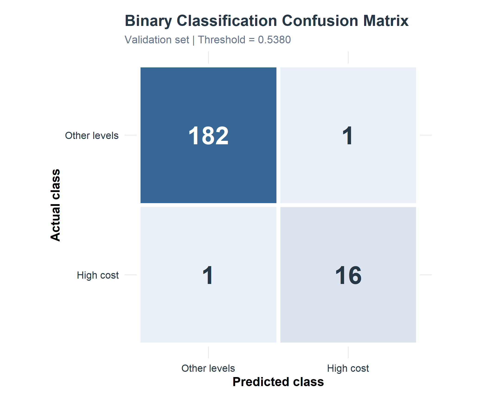

The final model correctly identified 16 of the 17 highest-cost individuals in the validation set, with one false positive and one false negative.

### Probability Calibration

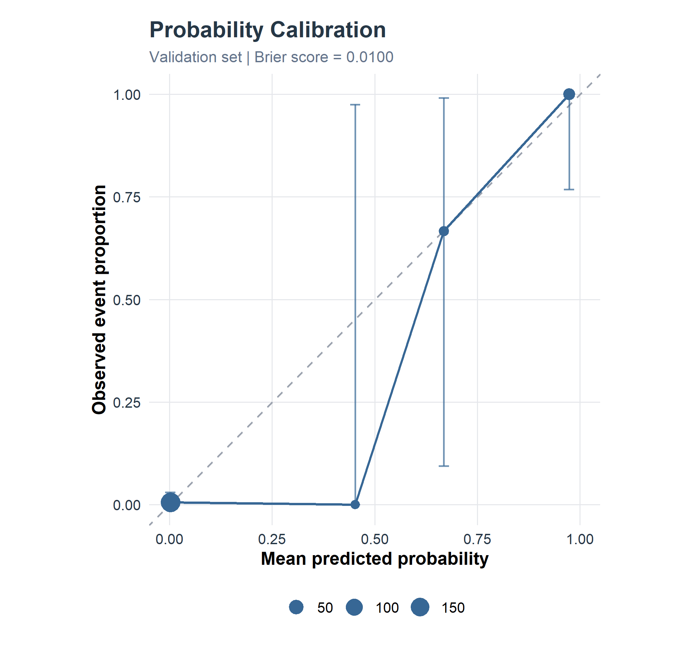

### Nonlinear Risk Effects

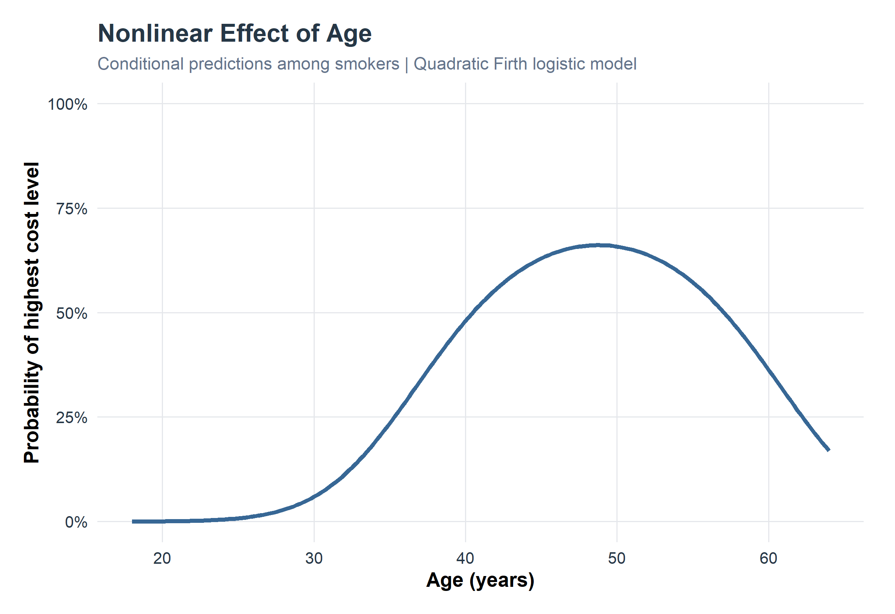

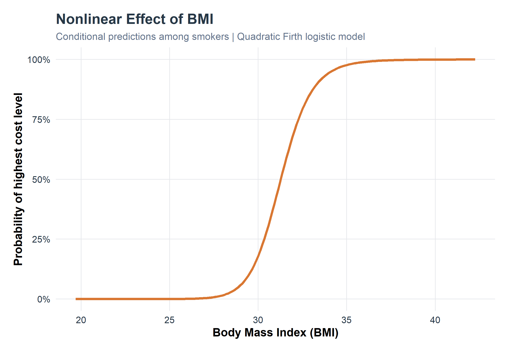

## 8. Technical Highlights

| Area | Methods |
|---|---|
| Statistical Modeling | Generalized Linear Models, cumulative logit regression |
| Statistical Inference | Maximum likelihood, Wald tests, likelihood ratio tests, confidence intervals |
| Nonlinear Modeling | Natural cubic splines, quadratic terms |
| Feature Relationships | Interaction effects |
| Model Diagnostics | Proportional odds, separation detection, collinearity, residuals and leverage |
| Bias Reduction | Firth penalized likelihood |
| Model Selection | Stratified cross-validation, held-out testing |
| Model Evaluation | QWK, MAE, ROC-AUC, PR-AUC, F1, Brier score |
| Decision Optimization | Classification threshold selection |
| Reproducibility | Fixed random seeds, saved split indices, renv, Git |

## 9. Repository Structure

```text
.
├── data/
│   ├── raw/
│   └── processed/
├── docs/
│   ├── 01_project_requirements.md
│   ├── 02_modeling_decisions.md
│   └── 03_project_acceptance.md
├── R/
│   ├── 01_data_preparation.R
│   ├── 02_eda.R
│   ├── 03_ordinal_logistic.R
│   ├── 04_model_comparison.R
│   ├── 05_binary_logistic.R
│   └── 06_visualization.R
├── reports/
├── results/
│   ├── figures/
│   ├── tables/
│   └── models/
├── renv.lock
├── .gitignore
├── README.md
└── README_CN.md
```

## 10. Reproducibility

### Environment

- R 4.6.1
- RStudio (recommended)
- renv for dependency management

### Restore Dependencies

Open the R project from the repository root and execute the following commands in the R console:

```r
install.packages("renv")
renv::restore()
renv::status()
```

If renv is already installed, the installation step can be skipped.

### Run the Analysis

Execute the scripts sequentially from the repository root:

```r
source("R/01_data_preparation.R")
source("R/02_eda.R")
source("R/03_ordinal_logistic.R")
source("R/04_model_comparison.R")
source("R/05_binary_logistic.R")
source("R/06_visualization.R")
```

Ensure that final validation is enabled in scripts 04 and 05 when reproducing the reported validation results.

The workflow saves processed data, split indices, fitted models, evaluation tables, and figures.

The full analysis has been rerun successfully in a clean local R session. Cross-platform reproducibility has not been independently verified.

## 11. Main Findings

- Smoking status is strongly associated with higher medical cost levels in the observed dataset.
- Incorporating BMI-related interaction effects substantially improves ordinal classification performance.
- Natural cubic splines provide a modest additional improvement over the linear interaction model.
- Firth penalized likelihood addresses the unstable parameter estimation caused by separation.
- Quadratic age and BMI terms improve the probability predictions of the binary model on the testing set.
- Statistical diagnostics and model interpretability remain important even when predictive performance is high.

## 12. Limitations

- The dataset contains only 1,338 observations.
- The ordinal proportional odds assumption is not fully satisfied.
- Intermediate medical cost categories remain more difficult to classify.
- The binary validation set contains only 17 positive cases.
- The strong separation structure may partly explain the exceptionally high binary classification performance.
- External validation and formal sensitivity analysis of influential observations remain necessary.
- Observed statistical associations should not be interpreted as causal relationships.
- The models are not intended for direct clinical or insurance pricing decisions.

## 13. Documentation

Detailed project materials are available in:

- [Project Requirements](docs/01_project_requirements.md)
- [Modeling Decisions](docs/02_modeling_decisions.md)
- [Project Acceptance](docs/03_project_acceptance.md)
- [Statistical Analysis Report](reports/)
- [Evaluation Tables](results/tables/)
- [Visualization Results](results/figures/)

## 14. Author

**Li Xin**

Graduate Student in Applied Statistics  
Beijing Normal University

Research interests: Statistical Modeling, Machine Learning and Data Analytics.
