# 医疗保险费用等级预测与高费用风险分析

[English](README.md) | [简体中文](README_CN.md)


## 1. 项目简介

本项目基于广义线性模型（Generalized Linear Models, GLMs），构建医疗保险费用等级预测与高费用风险识别的可复现统计建模框架。

项目不仅关注模型的预测表现，还将统计推断、模型诊断、非线性建模、模型选择及样本外评价纳入完整分析流程。

### 研究目标

- 分析与医疗保险费用等级相关的主要因素。
- 使用有序 Logistic 回归预测九个医疗费用等级。
- 通过交互效应与非线性建模改善预测表现。
- 识别可能进入最高医疗费用等级的高风险群体。
- 使用 Firth 惩罚似然估计解决数据分离与最大似然估计不稳定问题。

## 2. 核心成果

| 研究任务 | 最终模型 | 核心指标 |
|---|---|---|
| 有序分类 | 样条交互累积 Logit 模型 | QWK = 0.9125 |
| 有序分类 | 样条交互累积 Logit 模型 | Accuracy = 80.25% |
| 高费用风险识别 | 二次项 Firth Logistic 回归 | ROC-AUC = 0.9939 |
| 高费用风险识别 | 二次项 Firth Logistic 回归 | Recall = 94.12% |
| 高费用风险识别 | 二次项 Firth Logistic 回归 | F1 = 0.9412 |

以上指标均来自独立验证集。

## 3. 数据集介绍

数据来源于《广义线性模型》课程 Project。

- 样本数量：1,338
- 原始解释变量列数：9
- 重构后解释变量数量：6
- 响应变量：医疗费用等级（0–8）
- 最高费用等级样本：113 条，占比 8.45%

| 变量 | 含义 | 类型 |
|---|---|---|
| age | 投保人年龄 | 数值型 |
| sex | 性别 | 分类变量 |
| bmi | 身体质量指数 | 数值型 |
| children | 子女数量 | 计数型 |
| smoker | 吸烟状态 | 二分类变量 |
| region | 所在地区 | 分类变量 |
| y | 医疗费用等级 | 有序分类变量 |

将原始数据中的四个地区指示变量重构为一个分类变量。

响应变量取值越大，表示医疗费用等级越高。原始数据未提供各等级对应的具体金额阈值。

## 4. 项目分析流程

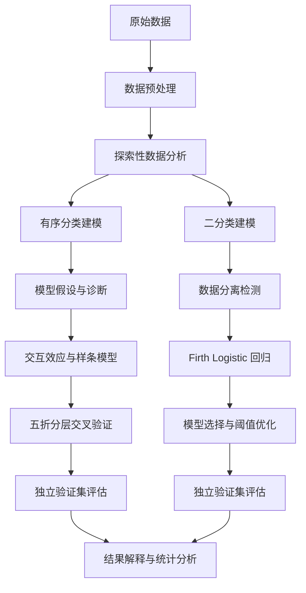

## 5. 探索性数据分析

通过描述性统计和数据可视化，分析医疗费用等级、人口特征、吸烟状态、BMI 及其与响应变量之间的关系。

### 医疗费用等级分布

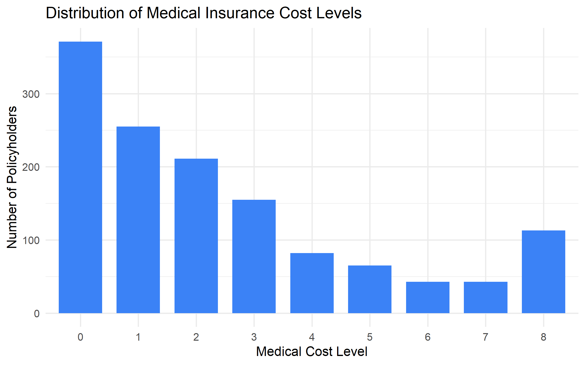

### BMI、吸烟状态与医疗费用等级

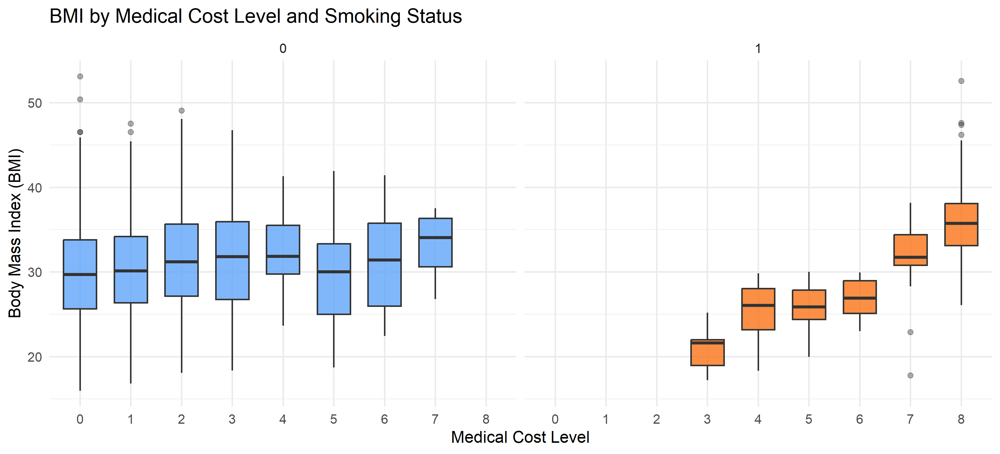

探索性分析表明，吸烟状态与医疗费用等级存在较强关联，BMI 与费用等级之间可能存在非线性关系，为后续引入交互项及非线性项提供依据。

## 6. 有序 Logistic 回归

### 6.1 建模方法

考虑到响应变量具有明确的顺序关系，采用累积 Logit 模型进行建模。

建立三个候选模型：

- 基础比例优势模型
- BMI 与吸烟状态交互模型
- 自然三次样条与吸烟状态交互模型

主要统计分析包括：

- 最大似然参数估计
- 似然比检验
- 比例优势假设检验
- 多重共线性诊断
- 数值收敛诊断
- 非线性效应与交互效应分析

### 6.2 模型比较与选择

将数据划分为933条训练样本和405条独立验证样本。

在训练集内部实施五折分层交叉验证，以二次加权 Cohen's Kappa（QWK）作为主要模型选择指标。

| 模型 | 平均 Accuracy | 平均 MAE | 平均 QWK |
|---|---:|---:|---:|
| 基础模型 | 0.7031 | 0.6989 | 0.8264 |
| 交互模型 | 0.7888 | 0.4845 | 0.8799 |
| **样条交互模型** | **0.7942** | **0.4460** | **0.8878** |

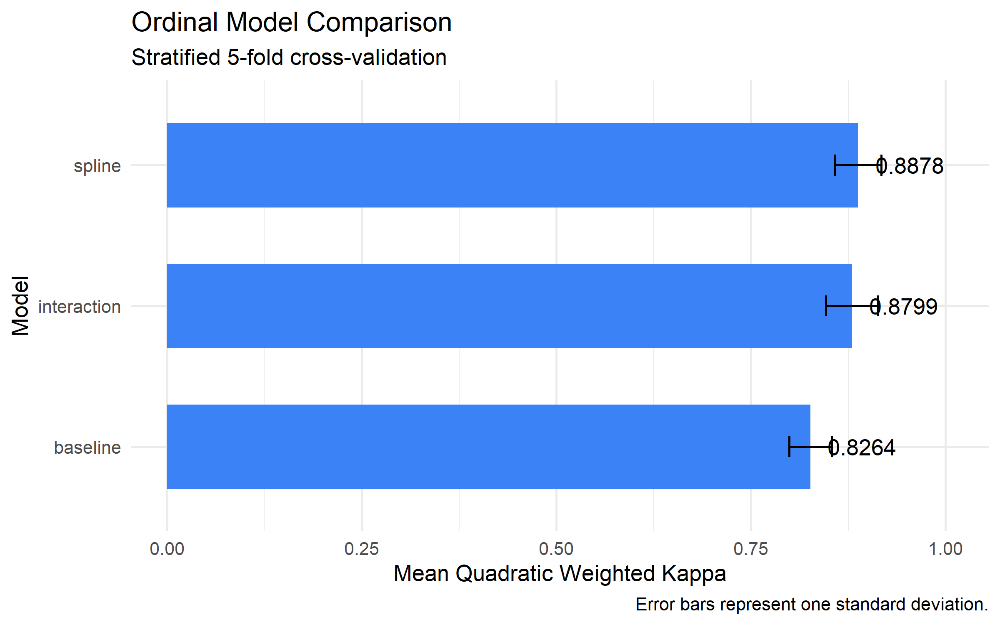

样条交互模型取得最高的平均交叉验证 QWK，因此选择该模型进行最终验证。

### 6.3 独立验证集表现

| 评价指标 | 结果 |
|---|---:|
| Accuracy | 80.25% |
| MAE | 0.3951 |
| QWK | 0.9125 |
| 误差不超过一级 | 90.86% |
| 误差不超过两级 | 93.83% |

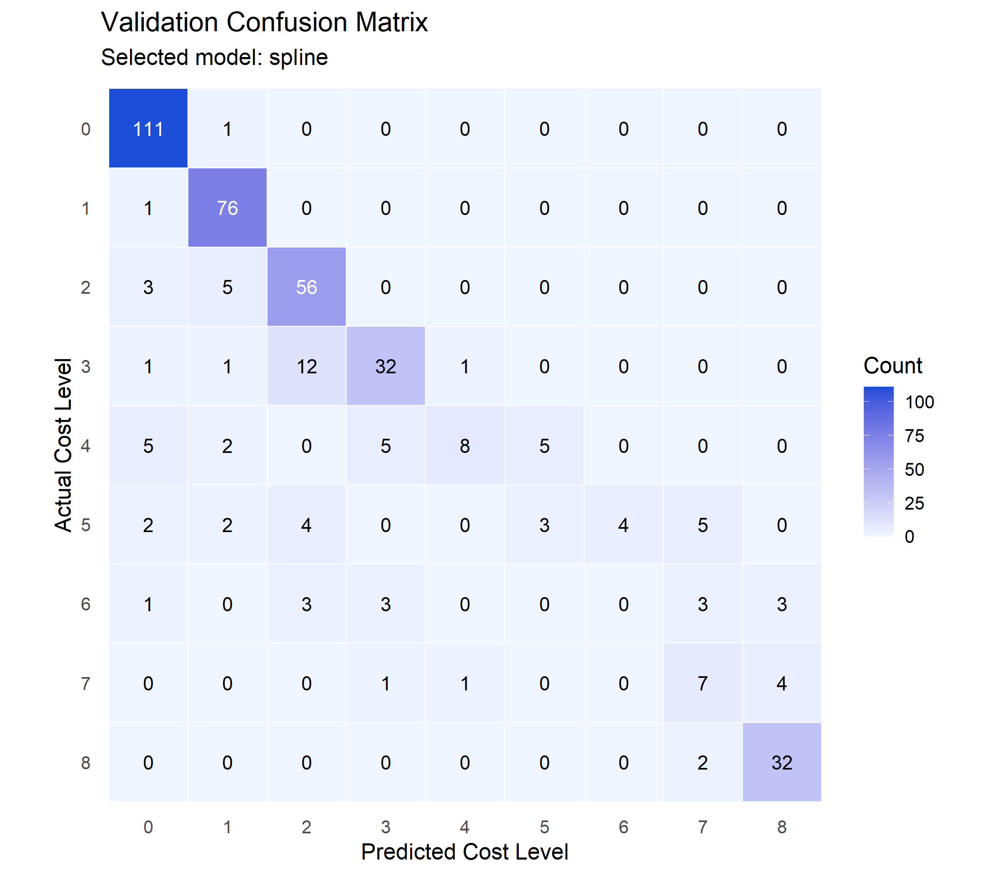

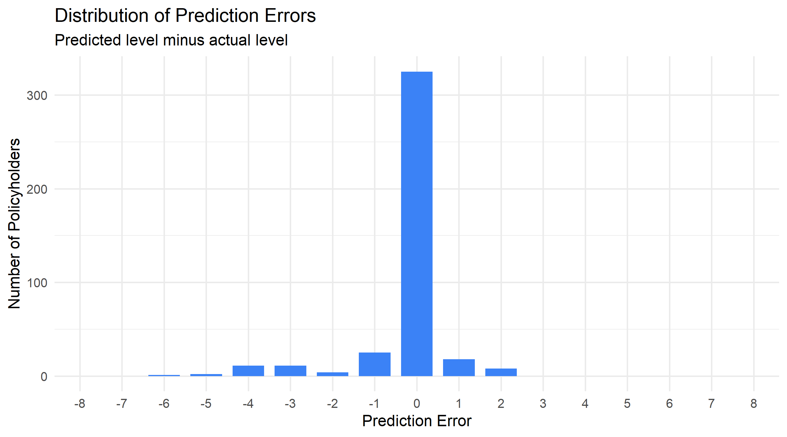

### 6.4 非线性效应与交互效应

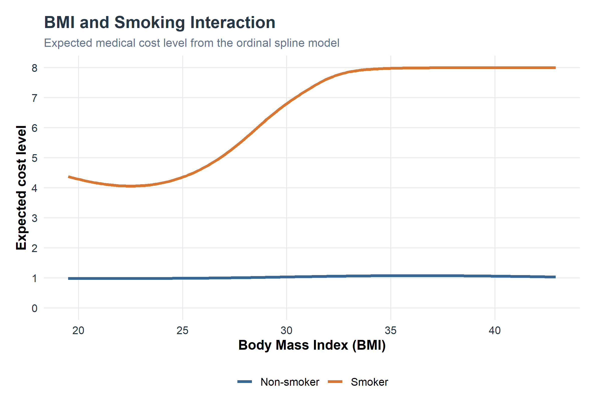

最终模型能够刻画不同吸烟状态下 BMI 与医疗费用等级之间的非线性关系。

尽管模型取得较好的预测表现，但比例优势假设并未完全满足，因此对模型参数的统计解释仍需保持谨慎。

## 7. 最高医疗费用等级风险识别

### 7.1 二分类目标构造

将最高医疗费用等级（y = 8）定义为正类，其余等级定义为负类。

| 数据集 | 样本数量 | 正类数量 |
|---|---:|---:|
| 训练集 | 937 | 79 |
| 检验集 | 201 | 17 |
| 验证集 | 200 | 17 |

检验集用于模型选择与分类阈值优化，验证集仅用于最终评价。

### 7.2 数据分离与 Firth 修正

普通二分类 Logistic 回归存在准完全分离问题。

在观测数据中，最高医疗费用等级样本均来自吸烟群体，导致普通最大似然估计出现异常大的回归系数及标准误。

因此引入 Firth 惩罚似然估计，以获得有限且更加稳定的参数估计。

### 7.3 候选模型比较

| 模型 | ROC-AUC | Log Loss | Brier Score |
|---|---:|---:|---:|
| 基础 Firth 模型 | 0.99968 | 0.02296 | 0.00589 |
| 交互 Firth 模型 | 0.99968 | 0.02472 | 0.00613 |
| 样条 Firth 模型 | 1.00000 | 0.02101 | 0.00526 |
| **二次项 Firth 模型** | **1.00000** | **0.01820** | **0.00429** |

以上为检验集评价结果。

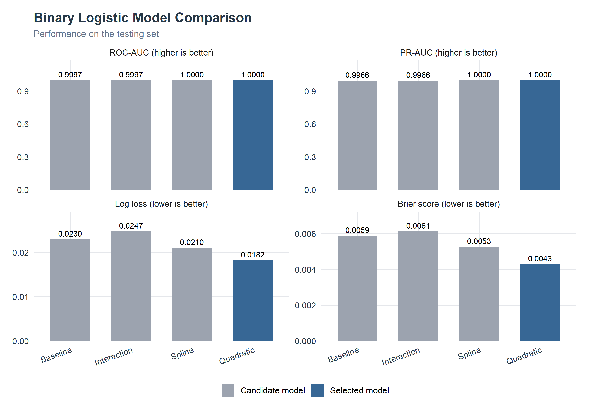

综合考虑模型预测能力、概率预测质量、非线性项诊断及模型简洁性，最终选择包含年龄与 BMI 二次项的 Firth Logistic 回归模型。

在检验集上采用最大 F1 策略确定最终分类阈值：

**Threshold = 0.5379624**

### 7.4 独立验证集表现

| 评价指标 | 结果 |
|---|---:|
| ROC-AUC | 0.9939 |
| PR-AUC | 0.9657 |
| Average Precision | 0.9663 |
| Accuracy | 99.00% |
| Precision | 94.12% |
| Recall | 94.12% |
| Specificity | 99.45% |
| F1 Score | 0.9412 |
| Log Loss | 0.04627 |
| Brier Score | 0.00996 |

### ROC 曲线与 PR 曲线

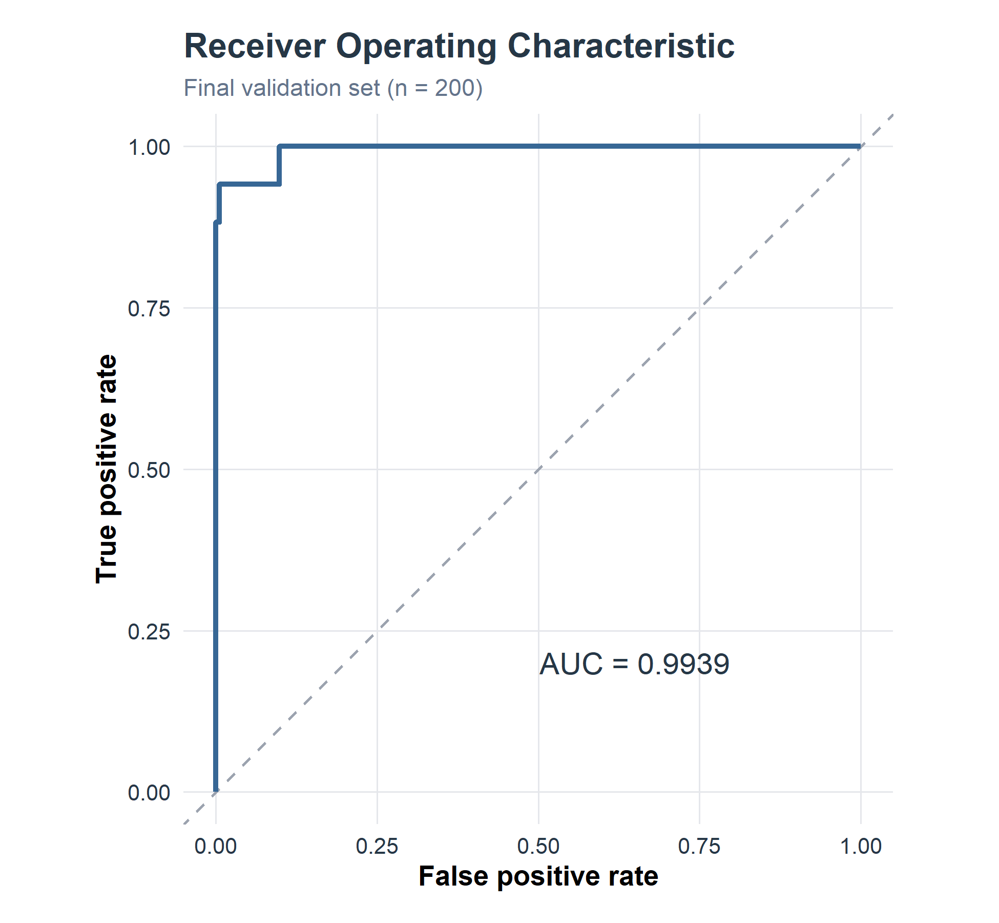

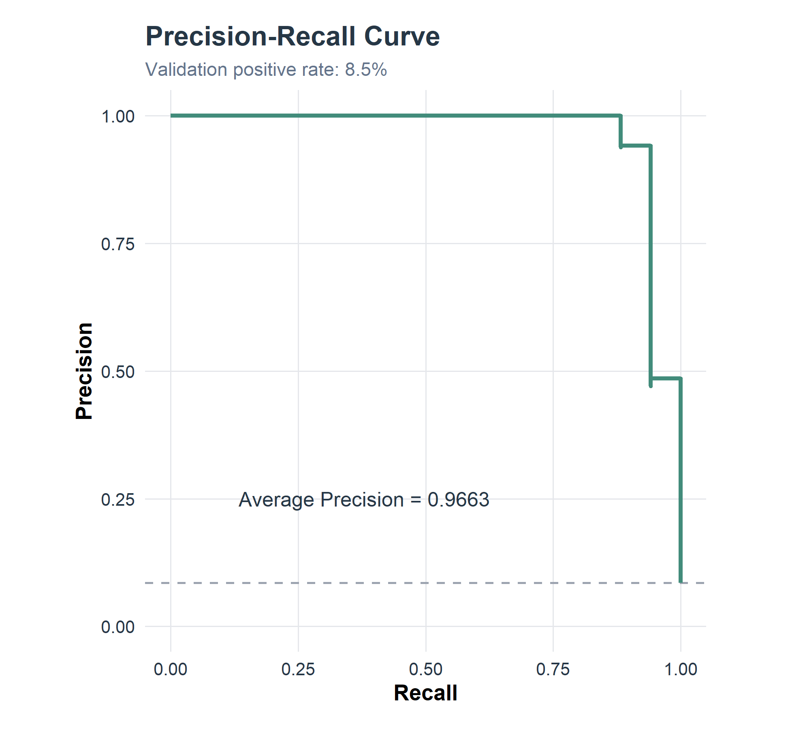

### 混淆矩阵

| 实际类别 / 预测类别 | 负类 | 正类 |
|---|---:|---:|
| 负类 | 182 | 1 |
| 正类 | 1 | 16 |

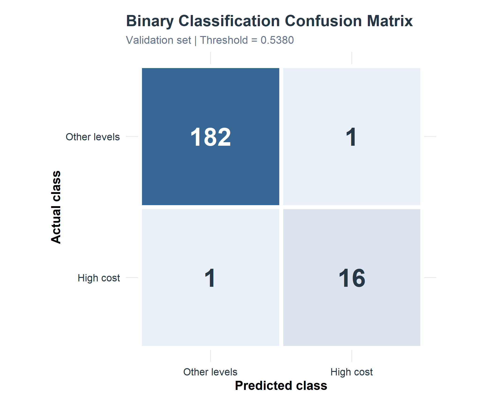

最终模型成功识别验证集中17名最高费用等级个体中的16名，产生1个假阳性及1个假阴性。

### 概率校准

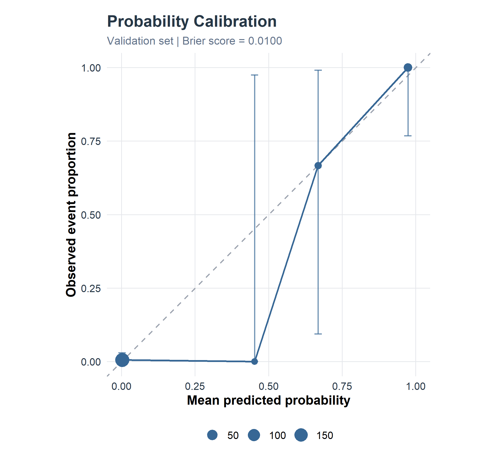

### 非线性风险效应

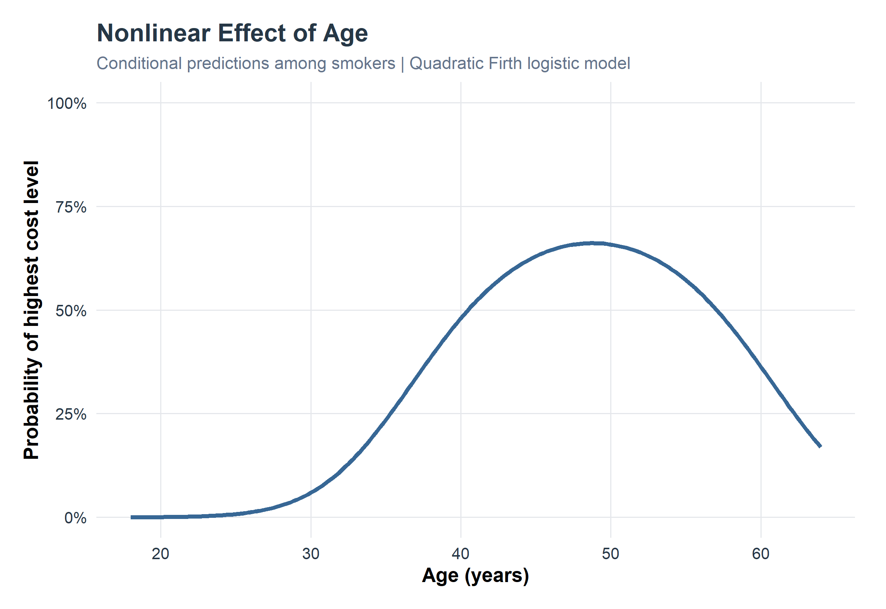

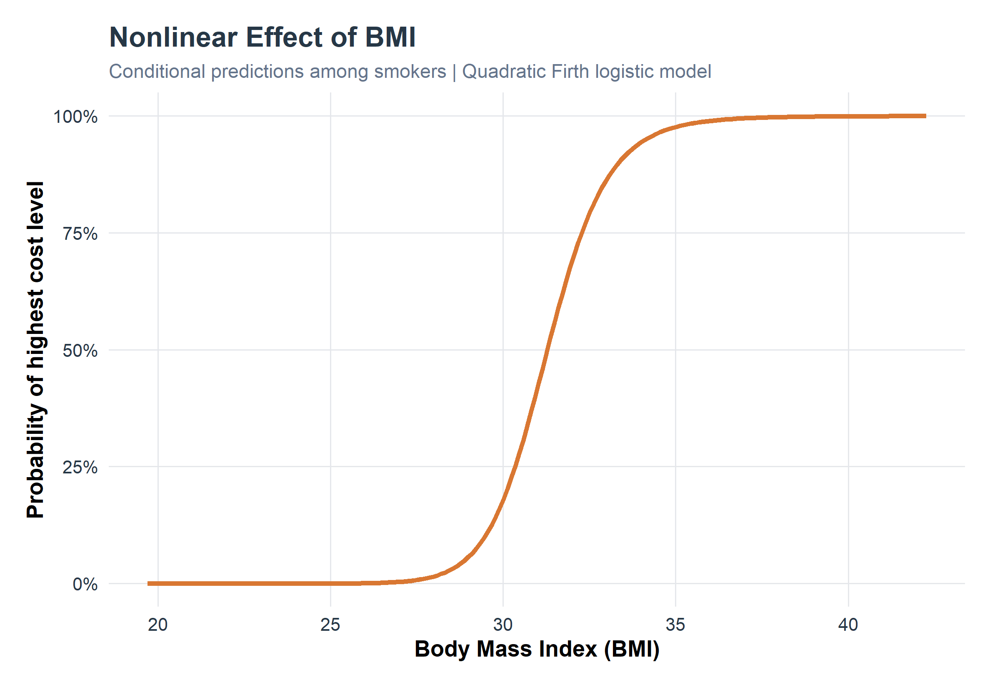

## 8. 项目技术亮点

| 技术模块 | 主要方法 |
|---|---|
| 统计建模 | 广义线性模型、累积 Logit 回归 |
| 统计推断 | 最大似然估计、Wald 检验、似然比检验、置信区间 |
| 非线性建模 | 自然三次样条、二次项 |
| 特征关系建模 | 交互效应 |
| 模型诊断 | 比例优势假设、分离检测、共线性、残差及杠杆值 |
| 偏差修正 | Firth 惩罚似然估计 |
| 模型选择 | 分层交叉验证、独立检验集 |
| 模型评价 | QWK、MAE、ROC-AUC、PR-AUC、F1、Brier Score |
| 分类决策 | 分类阈值优化 |
| 工程可复现性 | 固定随机种子、划分索引保存、renv、Git |

## 9. 项目目录结构

```text
.
├── data/
│   ├── raw/                     # 原始数据
│   └── processed/               # 建模数据与划分索引
├── docs/
│   ├── 01_project_requirements.md
│   ├── 02_modeling_decisions.md
│   └── 03_project_acceptance.md
├── R/
│   ├── 01_data_preparation.R    # 数据预处理
│   ├── 02_eda.R                 # 探索性数据分析
│   ├── 03_ordinal_logistic.R    # 有序回归与模型诊断
│   ├── 04_model_comparison.R    # 模型比较与预测
│   ├── 05_binary_logistic.R     # 二分类风险建模
│   └── 06_visualization.R       # 结果可视化
├── reports/                     # 统计分析报告
├── results/
│   ├── figures/                 # 分析图形
│   ├── tables/                  # 实验结果表格
│   └── models/                  # 模型对象
├── renv.lock                    # 软件包依赖记录
├── .gitignore
├── README.md
└── README_CN.md
```

## 10. 环境配置与结果复现

### 开发环境

- R 4.6.1
- RStudio（推荐）
- renv 软件包依赖管理

### 恢复项目依赖

在项目根目录打开 RStudio 项目，在 R Console 中执行：

```r
install.packages("renv")
renv::restore()
renv::status()
```

如果已经安装 renv，可以跳过安装步骤。

### 运行完整分析流程

按照以下顺序执行全部脚本：

```r
source("R/01_data_preparation.R")
source("R/02_eda.R")
source("R/03_ordinal_logistic.R")
source("R/04_model_comparison.R")
source("R/05_binary_logistic.R")
source("R/06_visualization.R")
```

复现最终验证集结果时，需要确认脚本04和05中的最终验证开关已开启。

项目将自动生成处理后的数据、数据划分索引、模型对象、统计结果表格及可视化图形。

完整分析流程已在干净的本地 R 会话中成功复现，尚未进行独立的跨平台复现测试。

## 11. 主要研究结论

- 吸烟状态与医疗费用等级存在较强的统计关联。
- 引入 BMI 与吸烟状态的交互效应能够明显改善有序分类预测表现。
- 自然三次样条在交互模型基础上进一步改善预测表现，但提升幅度相对有限。
- Firth 惩罚似然估计能够解决数据分离导致的参数估计不稳定问题。
- 年龄与 BMI 二次项能够改善二分类模型在检验集上的概率预测质量。
- 即使模型取得较高的预测指标，统计假设检验、模型诊断及可解释性分析仍然不可忽视。

## 12. 项目局限性

- 数据集样本规模相对有限。
- 有序回归模型的比例优势假设未完全满足。
- 模型对部分中间费用等级的识别能力仍有不足。
- 二分类验证集仅包含17个正类样本。
- 数据中较强的分离结构可能是二分类模型预测表现较高的原因之一。
- 尚需开展外部验证及潜在影响点的正式敏感性分析。
- 统计关联不能直接解释为因果关系。
- 本项目模型不宜直接用于实际临床决策或保险定价。

## 13. 项目文档

更多分析细节与实验结果见：

- [项目任务与验收要求](docs/01_project_requirements.md)
- [建模决策与实验记录](docs/02_modeling_decisions.md)
- [项目验收记录](docs/03_project_acceptance.md)
- [完整统计分析报告](reports/)
- [实验结果表格](results/tables/)
- [数据可视化结果](results/figures/)

## 14. 作者

**李欣**

北京师范大学 · 应用统计硕士研究生

研究兴趣：统计建模、机器学习与数据分析。
